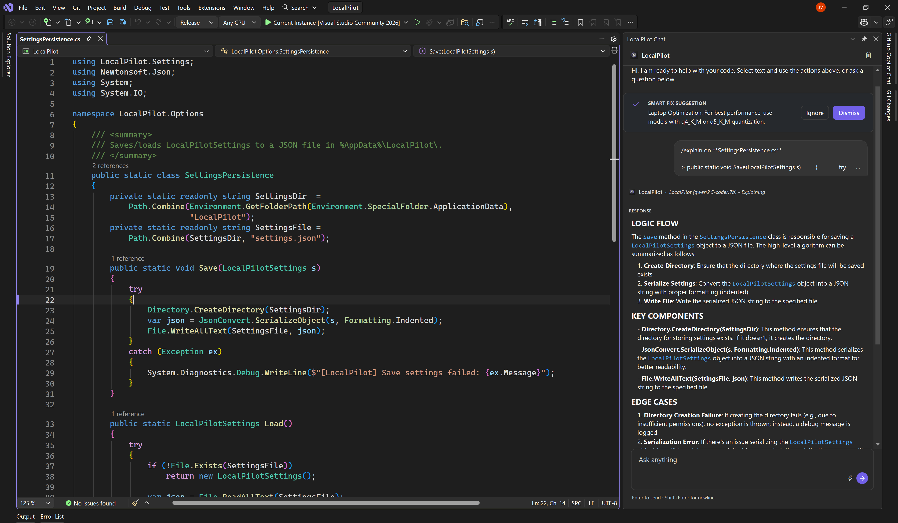
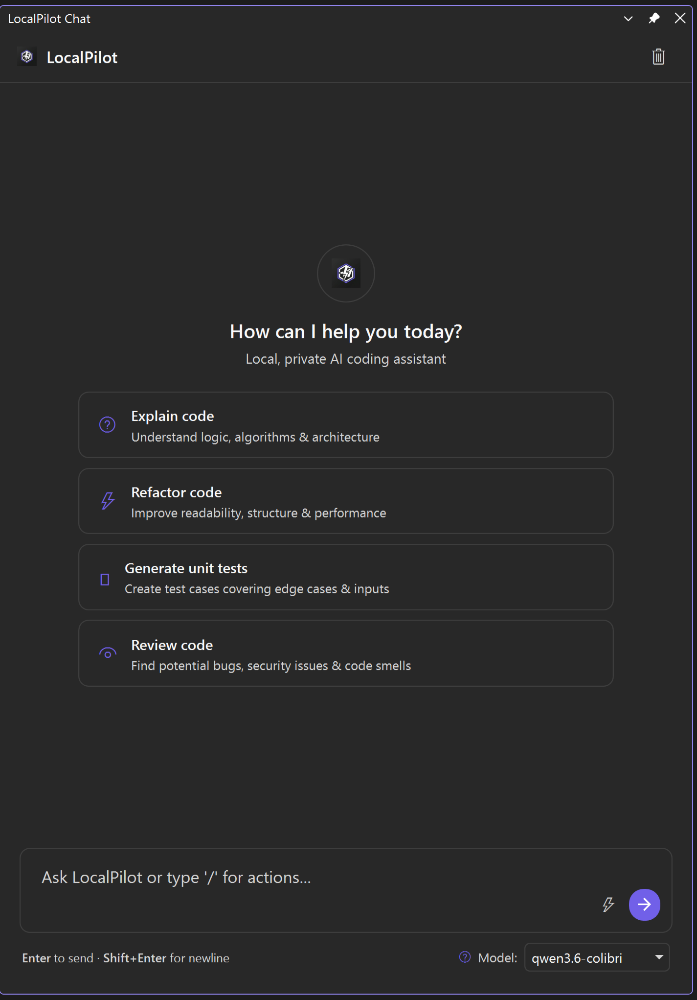
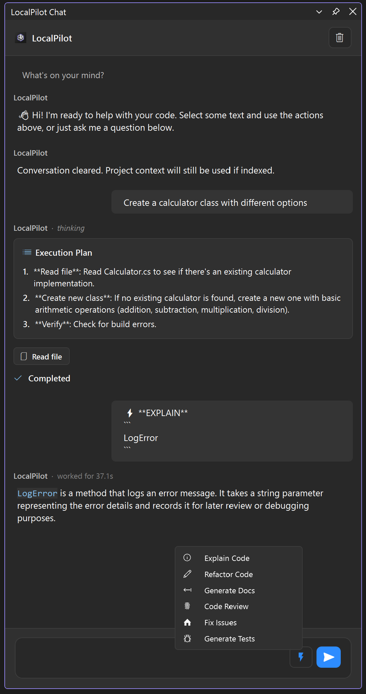
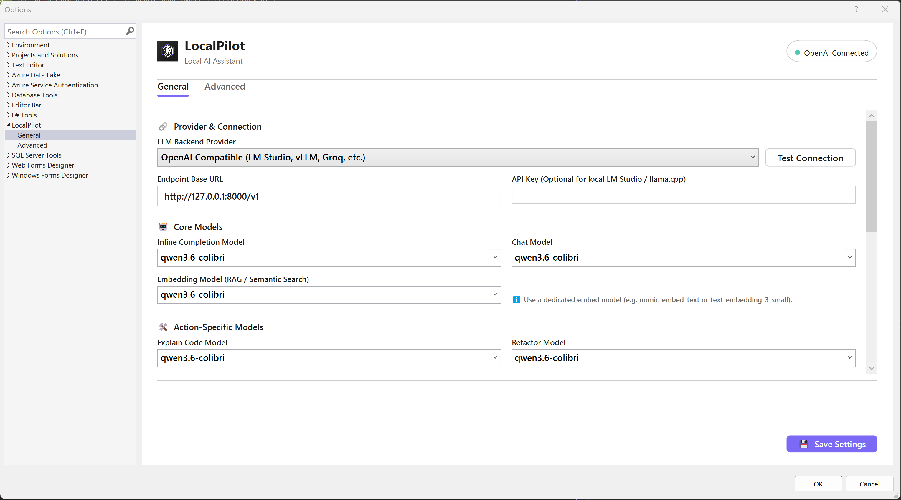

<div align="center">
  
  <h1>LocalPilot</h1>
  <p align="center">
    <strong>The Privacy-First AI Pair Programmer for Visual Studio.</strong><br />
    Bringing local &amp; OpenAI-compatible LLMs (Ollama, LM Studio,  vLLM, llama.cpp, OpenAI) directly into your IDE.
  </p>

  <p align="center">
    <a href="https://marketplace.visualstudio.com/items?itemName=FutureStackSolution.LocalPilotFSS">
      
    </a>
    <a href="https://github.com/FutureStackSolution/LocalPilot/blob/main/LICENSE">
      
    </a>
    <a href="https://ollama.com">
      
    </a>
    <a href="https://visualstudio.microsoft.com/">
      
    </a>
  </p>
</div>

---

## 🌟 Overview

**LocalPilot** is a high-performance Visual Studio extension that integrates local and OpenAI-compatible Large Language Models — including **[Ollama](https://ollama.com)**, **LM Studio**, **vLLM**, **llama.cpp**, and **OpenAI** (`gpt-4o`, `gpt-5`, `o1`/`o3`/`o4`). It delivers inline ghost-text completions, an agentic AI chat panel, inline editor diffs, and native `Ctrl+.` lightbulb actions with full local privacy.

<p align="center">
  
</p>

---

## 🚀 Key Features

<table>
  <tr>
    <td width="50%" valign="top">
      <h3>💬 Advanced Chat Panel</h3>
      A dedicated side panel for complex reasoning, code generation, and deep-dive technical discussions.
      <br/>
            <br/>
      <p align="center">
        
      </p>
    </td>
    <td width="50%" valign="top">
      <h3>⚡ Contextual Quick Actions</h3>
      Instant access to Refactor, Explain, or Document code directly from your right-click context menu.
      <br/>
            <br/>
      <p align="center">
        
      </p>
    </td>
  </tr>
  <tr>
    <td width="50%" valign="top">
      <h3>🛠️ Flexible Configuration</h3>
      Easily manage your Ollama connection and assign different models for chat and autocomplete tasks.
      <br/>
            <br/>
      <p align="center">
        
      </p>
    </td>
    <td width="50%" valign="top">
      <h3>✨ Ghost-Text & Performance</h3>
      <ul style="list-style-type: none; padding-left: 0;">
        <li>🚀 <strong>Real-time Suggestions</strong>: Zero-latency inline code completions.</li>
        <li>🏠 <strong>Local-First, Cloud-Optional</strong>: Run 100% offline locally, or connect your own OpenAI-compatible API.</li>
        <li>⚡ <strong>Optimized</strong>: Designed for minimal impact on IDE performance.</li>
      </ul>
    </td>
  </tr>
</table>


---

## 🛡️ Why LocalPilot?

- **🔒 Local-First Privacy (No Telemetry)**: LocalPilot itself collects zero telemetry. When paired with local backends (Ollama, LM Studio,  llama.cpp), your source code never leaves your machine—ideal for air-gapped and sensitive projects.
- **🔌 Flexible Backends (Local or Cloud)**: Use local GPUs for offline speed and zero cost, or optionally plug in your own OpenAI / OpenAI-compatible endpoint and API key whenever you need cloud-scale models.
- **⚡ Built for Speed**: Native FIM completions, Roslyn AST skeletonization, line-numbered edits, and SQLite indexing keep context lean and responses fast.
- **🎨 Native Experience**: Designed to feel like a built-in Visual Studio feature—with inline editor diffs, `Ctrl+.` lightbulb actions, and native Light/Dark theme support.

---

## 🛠️ Getting Started

### 1️⃣ Prerequisites
Run any supported local or OpenAI-compatible backend:
- **Ollama**: [ollama.com](https://ollama.com) (`http://localhost:11434`)
- **LM Studio /  vLLM / llama.cpp**: Enable the OpenAI-compatible server (e.g., `http://localhost:1234/v1` or `http://127.0.0.1:8000/v1`)
- **OpenAI API**: `https://api.openai.com/v1` with your API key
  ```bash
  ollama run qwen2.5-coder:7b
  ```

### 2️⃣ Installation
1. Visit the **[Visual Studio Marketplace](https://marketplace.visualstudio.com/items?itemName=FutureStackSolution.LocalPilotFSS)**.
2. Click **Download**, or search for "LocalPilot" within the Visual Studio Extension Manager:
   - *Extensions > Manage Extensions > Online*
3. Restart Visual Studio to complete the installation.

### 3️⃣ Configuration
Navigate to **Tools > Options > LocalPilot > Settings**.
1. **Provider & Endpoint URL**: Choose **Ollama** (`http://localhost:11434`) or **OpenAI-Compatible** (LM Studio `http://localhost:1234/v1`,  or OpenAI `https://api.openai.com/v1` + optional API key). Click **"Test Connection"** to verify.
2. **Model Assignments**: Assign preferred models for **Chat**, **Inline Completions**, and specialized actions.

> [!TIP]
> For the best experience in **v2.0**, we recommend:
> - **Chat/Logic**: `qwen2.5-coder:7b` or `llama3.1:8b` (Excellent reasoning & tool use, fits comfortably in 4–8GB VRAM).
> - **Inline Completions**: `qwen2.5-coder:1.5b` or `starcoder2:3b` (Native FIM support & lowest latency).
> - **Embedding / RAG**: `nomic-embed-text` or `mxbai-embed-large` *(Optional — if unsupported by your endpoint, LocalPilot caches that capability and falls back cleanly to keyword search.)*

---

## 📖 Usage Guide

### 💡 Inline Completion
Simply start typing in any supported file. LocalPilot will provide translucent "ghost-text" suggestions.
- **`Tab`**: Accept the suggestion.
- **`Esc`**: Dismiss the suggestion.

### 💬 Chat Assistant
The dedicated AI chat panel can be summoned at any time:
- **Global Shortcut**: Press **`Alt + L`** to toggle the chat window.
- **LocalPilot Menu**: Access Chat and Settings directly from the top-level **LocalPilot** menu or the **Tools > LocalPilot** menu in Visual Studio.

### ⚡ Contextual Actions
Right-click on any code selection or use the **LocalPilot** menu to access:
- **Explain Code**: Deep-dive breakdown of complex logic and algorithms.
- **Fix Issues**: One-click autonomous resolution for build and runtime errors.
- **Refactor**: Suggest improvements for readability, performance, and DRY.
- **Review Code**: Senior-level analysis for security, patterns, and bugs.
- **Generate Docs**: Auto-generate XML/docstring comments.
- **Generate Unit Tests**: Create comprehensive test suites for your logic.
- **Rename Symbol**: Project-wide semantic renaming powered by Roslyn.

### ⌨️ Slash Commands
Use these directly in the Chat panel for rapid interactions:
- `/explain`: Analyze selected code.
- `/fix`: Diagnose and fix the current build error or selection.
- `/review`: Perform a technical review of the code.
- `/test`: Generate NUnit/XUnit/Jest test cases.
- `/map`: Refresh and summarize the project knowledge graph.
- `/doc`: Generate professional documentation.

### 🛡️ Smart Fix Protocol
LocalPilot v1.5 is proactive. If you have active compilation errors, a **Smart Fix Banner** will automatically appear in your chat. Clicking "Fix with AI" will trigger the agent to analyze the error and the surrounding code, proposing a surgical fix that you can apply with a single click.

---

## 🤝 Contributing

We welcome community contributions! Whether it's bugs, features, or documentation, your help is appreciated.

### 🛠️ How to Help
1. **Check Issues**: See the [Existing Issues](https://github.com/FutureStackSolution/LocalPilot/issues) to avoid duplicates.
2. **Clear Reports**: For bugs, include your VS version, Ollama model, and reproduction steps.
3. **Pull Requests**: Create a branch from `main`, ensure the project builds, and submit your PR with a clear description.

---

## 💻 Hardware Requirements

Since **LocalPilot** can run Large Language Models (LLMs) **locally on your machine** (via Ollama, LM Studio  or llama.cpp), your hardware directly impacts local inference speed (or you can connect a remote OpenAI / OpenAI-compatible endpoint if your workstation has limited VRAM).

### 🏁 Minimum Requirements
*   **CPU**: Recent Multi-core processor (Intel i5/AMD Ryzen 5 or equivalent).
*   **RAM**: 8GB (16GB+ strongly recommended for a smooth experience).
*   **GPU**: 4GB VRAM (Dedicated NVIDIA or Apple Silicon GPU preferred for faster inference).
*   **Storage**: 5GB+ for model storage (SSD/NVMe highly recommended).

### 🚀 Recommended for "Pro" Experience
*   **RAM**: 32GB+ for handling larger models (13B+) alongside Visual Studio.
*   **GPU**: NVIDIA RTX 3060/4060 or higher with 12GB+ VRAM.
*   **NVIDIA CUDA**: Ensure latest drivers are installed for GPU acceleration.

> [!IMPORTANT]
> LocalPilot is designed for efficiency, but because it performs all AI processing locally, it requires capable hardware. If suggestions feel slow, consider using a smaller, quantized model (e.g., `qwen2.5-coder:1.5b` or `llama3.1:8b`) in the settings.

---

## 📜 Release History

### 🚀 v2.0.0 - The Multi-Provider, Inline Diff & Performance Update (latest)
**"Full OpenAI-compatible support, inline editor diffs, native Ctrl+. Lightbulb actions, and ultra-lean local inference."**

- **🔌 Multi-Provider & Full OpenAI Model Compatibility**: Seamless support for **Ollama**, **LM Studio**, **vLLM**, **llama.cpp**, and **OpenAI** (`gpt-4o`, `gpt-4.1`, `gpt-5`, `o1`, `o3`, `o4-mini`), including proactive `max_completion_tokens`/`temperature` handling, adaptive HTTP 400 parameter negotiation, and human-readable error formatting.
- **🎨 Inline Editor Diff Adornments (`✓ Keep` / `✕ Undo`)**: Added `InlineDiffService` and MEF-exported `LocalPilotInlineDiff` editor adornments to highlight added/modified lines directly inside Visual Studio with per-hunk **Keep / Undo** controls.
- **💡 Native Visual Studio Lightbulb (`Ctrl+.`) Integration**: Added `ISuggestedActionsSourceProvider` (`LocalPilotSuggestedActionsProvider`) surfacing **Fix with LocalPilot**, **Refactor with LocalPilot**, and **Generate Unit Tests with LocalPilot** directly on red squiggles and code blocks—executing headlessly without switching to the chat pane.
- **↺ One-Click Turn Checkpoint & Revert**: Added `TurnCheckpointService` to snapshot pre-turn file states (including deleting newly created files on revert) with a **`↺ Revert Turn`** button on completed agent turn badges.
- **⚡ Ultra-Lean Fast Mode & Line-Numbered Edits (`edit_lines`)**: Added `EditLinesTool` with in-memory Roslyn pre-flight syntax validation (`ValidateCSharpSyntax`), `CodeSkeletonizer.SkeletonizeWithLineNumbers` (preserving exact 1-based line numbers), 2-zone sliding history, live tool-call streaming throughput (`tok/s`), per-chunk stream inactivity watchdogs, and a non-blocking SSD-offload warning banner (`< 5 tok/s`).
- **🎛️ In-Chat Model Switcher ([#46](https://github.com/FutureStackSolution/LocalPilot/issues/46))**: Added a quick model selector dropdown directly inside the Chat toolbar, with placeholder guards so unconfigured `(No models found)` states are never sent to the API.
- **🔧 Auto-Fix on Build Failure Toggle & Settings Hardening ([#50](https://github.com/FutureStackSolution/LocalPilot/issues/50), [#49](https://github.com/FutureStackSolution/LocalPilot/issues/49))**: Added the `Auto-Fix on Build Failure` option, configurable `KeepAliveDuration` (`15m` default), unload-models/connection resiliency, and fixed Options Cancel-save behavior.
- **🛡️ Agent Tool Execution, Custom GGUF & UI Layout Fixes ([#51](https://github.com/FutureStackSolution/LocalPilot/issues/51), [#54](https://github.com/FutureStackSolution/LocalPilot/issues/54), [#47](https://github.com/FutureStackSolution/LocalPilot/issues/47))**: Hardened `AgentOrchestrator`/`ToolRegistry` path and edit execution, added `HTTP 500` tool-template fallback for custom GGUF modelfiles, upgraded live markdown & Quick-Action card rendering, and refined chat layout/scroll behavior.
- **🗄️ SQLite Packaging & Full-Repo Stability Hardening ([#53](https://github.com/FutureStackSolution/LocalPilot/issues/53))**: Hardened SQLite WAL/SHM reset cleanup and packaging, debounced `FileSystemWatcher` startup storms, persisted `/v1/embeddings` capability checks, and resolved Roslyn, Nexus, `InlineCompletionController` per-tab isolation, and UI-thread lifecycle bugs.

### 🚀 v1.9.5 - The Accessibility & Resiliency Update
**"Dynamic font zoom, self-contained SQLite integration, and robust database parsing."**

- **🔍 Zoom & Font Scaling Support ([#44](https://github.com/FutureStackSolution/LocalPilot/issues/44))**: Resolved accessibility and text sizing issues. The Chat window now integrates seamlessly with Visual Studio environment fonts and supports interactive dynamic zoom via `Ctrl + Mouse Wheel`.
- **💬 Conversational Smart Context Bypass ([#25](https://github.com/FutureStackSolution/LocalPilot/issues/25))**: When typing short, friendly greetings (e.g., "hi", "hello", "thanks"), LocalPilot now skips heavy context retrieval (workspace maps, active code snippets, dependencies). This saves massive context token usage and results in lightning-fast response times.
- **⚙️ User-Configurable Request Timeout ([#42](https://github.com/FutureStackSolution/LocalPilot/issues/42))**: Added `RequestTimeoutSeconds` in the LocalPilot settings page, allowing users to customize request timeouts or let them auto-scale to accommodate slower local model inferences.
- **🗄️ SQLite Connection & Packaging Hardening ("Batteries Included") ([#41](https://github.com/FutureStackSolution/LocalPilot/issues/41))**: Bundled all critical SQLite dependencies (`SQLitePCLRaw.core.dll`, `SQLitePCLRaw.batteries_v2.dll`) directly within the VSIX package to prevent runtime interop exceptions, backed by dynamic SQLite environment initialization.
- **🛡️ Watcher Cleanup & Cancellation Safety ([#40](https://github.com/FutureStackSolution/LocalPilot/issues/40))**: Avoided memory and event listener leaks by adding automated directory watcher disposal when switching or closing solutions, and resolved thread-interruption crashes related to active cancellation token disposal.
- **📅 Culture-Invariant Date Parsing ([#39](https://github.com/FutureStackSolution/LocalPilot/issues/39))**: Fixed database synchronization errors by standardizing SQLite `LastIndexed` timestamp fields to a culture-invariant format (`yyyy-MM-dd HH:mm:ss`) combined with resilient parsing fallbacks.


### 🚀 v1.9.1 - The Stability & Hardening Update
**"Dynamic execution, resilient semantic refactoring, and a hardened agentic core."**

- **⚡ Dynamic Timeout Engine**: Implemented a task-complexity-aware timeout system that automatically scales from 60s to 300s for deep refactoring tasks.
- **🔧 Resilient Semantic Rename**: Re-engineered the project-wide rename tool with advanced fuzzy matching and Roslyn node-based recovery to handle inaccurate inputs from smaller models.
- **📂 Path Architecture Sanitization**: Implemented robust input sanitization and try-catch guards for all LLM-generated file paths to prevent runtime crashes.
- **🧠 History Compaction Safety**: Introduced a 45-second safety fuse for conversation history compaction, ensuring lightning-fast turn transitions in long sessions.
- **🔍 Surgical Indexing**: Replaced solution-wide prefill with surgical, index-driven tool lookups, significantly reducing agent "thinking" latency in massive solutions.
- **🚀 $O(N+M)$ Indexing Optimization**: Refactored Project Map generation to eliminate $O(N^2)$ bottlenecks, drastically reducing CPU spikes during background indexing.
- **🛡️ SQLite Connection Resilience**: Hardened the "Lazy Self-Healing" connection pattern across all services to eliminate intermittent concurrency and search-context exceptions.
- **🏠 Laptop-Friendly Throttling**: Hardened background I/O with strict `SemaphoreSlim` throttling (8 concurrent tasks) for maximum IDE responsiveness.
- **✅ VSTHRD Hardening**: Resolved all Visual Studio Threading Analyzer warnings (`VSTHRD105`, `VSTHRD110`) to ensure enterprise-grade reliability.

### 🚀 v1.9 - The Persistent Performance Update
**"Seamless SQLite storage, legacy-free architecture, and hardened stability."**

> [!IMPORTANT]
> **Breaking Architectural Change**: v1.9 completely replaces the legacy JSON-based indexing system with a high-performance **SQLite Persistent Storage Engine**.
> - **Automatic Migration**: Upon first launch, LocalPilot will automatically migrate your `.localpilot/index.json` and `nexus.json` data into the new SQLite database and delete the old files.
> - **Zero Latency**: This move eliminates IDE "stutters" during saves and allows LocalPilot to handle massive codebases with near-zero memory overhead.

- **🗄️ Persistent SQLite Storage**: Transitioned from memory-resident JSON indexing to a high-performance, asynchronous SQLite backend. This eliminates IDE freezes and significantly reduces RAM usage for large solutions.
- **🧹 Legacy Migration Engine**: Implemented a robust, self-healing migration layer that automatically ports old `index.json` and `nexus.json` data into the SQLite engine and cleans up legacy files.
- **🛡️ Serialization Hardening**: Resolved critical JSON deserialization errors during codebase migrations, ensuring a smooth transition for existing users.
- **📦 Workspace Integrity**: Added `.localpilot/` to default `.gitignore` templates to prevent local index databases from being accidentally committed to source control.

### 🚀 v1.8 - The Resilience & Architecture Update
**"Rock-solid background indexing, intelligent fallbacks, and user-configurable stability."**

- **🧹 Architectural Streamlining**: Conducted a comprehensive codebase audit to remove orphaned services and dead code, including the legacy `LocalParserProvider` in favor of the high-performance `UniversalSemanticProvider`.
- **🏗️ Consolidated Semantic Pipeline**: Refined the 3-Tier Semantic Priority Chain (`Roslyn` → `LSP` → `Universal`) to ensure zero-overlap and faster symbol discovery during complex refactoring turns.
- **📦 Model & Registry Pruning**: Streamlined the `AgentModels` and `CapabilityCatalog` to reduce memory footprint and improve logic maintainability for the core agentic workflow.
- **🧠 Decoupled & Resilient Embedding Engine**: Major architectural overhaul separating Chat and Background Indexing. LocalPilot now gracefully handles Ollama server drops with a robust Circuit Breaker and Exponential Backoff.
- **⚡ Dynamic Chunk Sizing**: Switched to dynamic character-count chunking (optimized for ~500 tokens) to vastly improve the quality and density of codebase vectors.
- **🛠️ Configurable Background Concurrency**: Introduced a new user-facing setting (slider) to throttle or accelerate background indexing based on your specific machine's capabilities.
- **🛡️ Keyword Search Fallback**: If you choose not to configure an Embedding model (or if your server trips the circuit breaker), LocalPilot will now instantly and gracefully fallback to a lightning-fast Keyword Search (BM25 style).

### 🚀 v1.7 - The Connectivity & Reliability Update
**"Smarter defaults, proactive error handling, and seamless first-run setup."**

- **🛠️ First-Run Auto-Discovery ([#25](https://github.com/FutureStackSolution/LocalPilot/issues/25))**: Automatically detects available Ollama models upon first installation and configures the extension defaults (e.g., `qwen2.5-coder`, `llama3.1`), resolving the common `404 Not Found` error for new users.
- **🛡️ Chat Connection Heartbeat**: The chat window now proactively validates the Ollama service and model selection, providing clear troubleshooting steps if the backend is unreachable or misconfigured.

### 🚀 v1.6 - The Polyglot Reliability Update
**"Smarter context, language-aware rename, and a hardened model pipeline."**

- **🧠 Dedicated Embedding Model Setting**: The RAG / semantic search pipeline now uses a separate, independently configurable **Embedding Model** (default: `nomic-embed-text`). Embedding and chat models are now fully decoupled.
- **🛡️ Embedding-Model Guard**: `OllamaService` now detects embed-only models (`nomic`, `bge-*`, `e5-*`, etc.) before sending them to `/api/chat` and surfaces a clear, actionable error message in the chat panel.
- **🌐 Polyglot Rename (C++ / Python / TS / Go)**: Improved project-wide renaming reliability for non-C# languages using a robust grep-and-replace strategy.
- **⚡ Context Window Fix (4096 → 16384+)**: Optimized dynamic context sizing to prevent tool-instruction truncation during complex agent sessions.
- **📦 Prompt Cache Invalidation**: Automatic eviction of stale prompt templates after updates, ensuring the latest system instructions are always active.
- **📋 Enhanced Logging**: Context allocation log now includes estimated input token counts for easier diagnostics.

### 🚀 v1.5 - The Performance & Precision Update
**"Blazing fast intelligence with zero hallucination overhead."**

- **⚡ Performance Shield for Quick Actions**: Significantly optimized informational tasks like `/explain`, `/doc`, and `/review`. By dynamically stripping "Worker" protocols and disabling native tools for read-only queries, LocalPilot now provides near-instant responses with 0% tool-hallucination risk.
- **🛠️ Self-Heal Engine (Smart Fix Protocol)**: Integrated a proactive verification layer that automatically triggers build-error checks after every agent edit. If an edit breaks the build, the agent detects it immediately and offers to fix or revert.
- **🛡️ Global Priority Guard**: A new resource orchestration layer that ensures the IDE remains responsive during heavy AI turns. Background tasks (RAG indexing, Nexus syncing) now automatically yield CPU/GPU resources the moment you start an agent turn and enter a smart 30s cooldown phase upon completion.
- **🌐 Nexus Intelligence**: Enhanced the agent's context with cross-language dependency awareness (C# ↔ TS/JS). The agent now "sees" the impact of backend changes on the frontend and vice versa.
- **🔄 OODA Turn Orientation**: Implemented a turn-by-turn feedback loop that prevents "agent amnesia." The orchestrator now summarizes the state of the task at every step to keep the model focused on the end goal.
- **🔍 Smart System Prompting**: LocalPilot now tailors its internal identity based on your task. It automatically switches between "Teacher" (informative) and "Worker" (surgical) personas to ensure you get the right tone and technical depth every time.
- **📦 Context Auto-Compaction**: Intelligent history management that automatically prunes and compacts older conversation turns, preventing local models from hitting token limits during long development sessions.
- **⚖️ Dynamic Context Allocation**: Quick Actions are now capped at 8k tokens and use compact project maps to ensure maximum inference speed on local laptop hardware while maintaining project-wide awareness.
- **🐛 Stability & Build Hardening**: Resolved critical type-mismatch errors in the Agentic loop and optimized the thread-safety of the cross-language dependency graph for enterprise-scale solutions.

### 🔨 v1.3 - The Autopilot & Security Update
**"A smarter, safer, and more integrated AI pair programming experience."**

- **🏎️ Autonomous Agent Mode (Gated Beta)**: LocalPilot now transforms from a simple chat assistant into a proactive agent. By combining high-reasoning models with local tools, the agent can now perform multi-step tasks like "Refactor this class and update all call sites" autonomously.
    - **📝 Smart Planning**: The agent generates a human-readable plan before taking any action.
    - **🔍 Local Tool Suite**: Integration with `read_file`, `grep_search`, `replace_text`, and `run_terminal` allows for deep project interaction.
    - **🔄 Plan-Act-Observe Loop**: A robust feedback loop ensures the agent verifies its work and recovers from errors intelligently.
- **🤖 Background Autopilot Indexing**: LocalPilot now automatically indexes your entire solution in the background. This enables zero-latency semantic search, allowing the AI to understand your project's structure and cross-file dependencies without manual context assembly.
- **🛡️ Human-in-the-Loop (HIL) Safety**: Introducing a critical security layer for autonomous coding. All write-based tool executions (creating files, updating code, deleting files) now require explicit user approval via a professional confirmation chip in the chat, giving you total control over your codebase.
- **📍 History-Aware Project Context**: The AI assistant is now smarter about recent conversation history and codebase state, using semantic embeddings to pull in relevant snippets precisely when they are needed for reasoning or refactoring.
- **✨ Premium UI Aesthetics**: Modernized the chat interface with high-fidelity "sparkle" glyphs, theme-aware "ghost" interaction models for buttons, and a more compact, distraction-free layout that stays out of your way.
- **⚙️ Core Performance & Stability**: Resolved critical UI thread deadlocks during code selection and hardened the streaming engine against local LLM fluctuations, ensuring a smooth and responsive experience even on base-tier hardware.

### 🔨 v1.2 - The Aesthetic & Intelligence Update
**"A major leap in visual fidelity and user experience refinement."**

- **✨ High-Fidelity Syntax Highlighting**: New theme-aware code renderer with a custom regex engine for premium visualization of methods, types, and strings.
- **🎨 Theme-Aware Palette**: Deep integration with VS Dark and Light themes—colors automatically adapt to your environment for maximum readability.
- **⌨️ Global Access Shortcut**: Added **`Alt + L`** as the universal command to instantly summon the AI Chat panel.
- **📂 Dedicated LocalPilot Menu**: A new top-level **LocalPilot** menu is now available (also accessible via **Tools > LocalPilot**) for rapid access to chat and settings.
- **🖼️ Minimalist Branding**: Refined the chat interface by removing redundant text labels, focusing purely on a clean, icon-centric AI persona.
- **🧠 Intelligent Status Tracking**: Resolved the "sticky thinking" bug; the AI now correctly transitions from "thinking" to "worked for X.Xs" without clutter.
- **🛡️ Robust Stream Rendering**: Hardened the UI update loop against rapid-fire AI streaming, preventing flickering and ensuring smooth output.

### 🔨 v1.1 - The Stability Update
**"The production-ready overhaul focusing on reliability and UX."**

- **✅ Selection Deadlock Fix**: Fundamental refactor of selection capture to prevent UI thread hangs during Quick Actions.
- **✅ Live Markdown Engine**: New incremental renderer provides a premium "typing" experience with real-time headers and list formatting.
- **✅ Hardened Container Logic**: Resolved critical `NullReferenceException` and `ObjectDisposedException` errors during intensive AI streaming.
- **✅ Thread-Safe Diagnostics**: Refactored the internal logger to be non-blocking and safe for background AI operations.
- **✅ Pro Marketplace Branding**: Formally aligned all project identifiers with the official `FutureStackSolution` namespace.

### ✨ v1.0 - Initial Release
- **Inline Ghost-Text**: Real-time code completions via Ollama.
- **Interactive Chat Panel**: Full technical discussion window.
- **Context Menu Actions**: Explain, Document, and Refactor support.
- **Native VS Support**: Full theme awareness for Light and Dark modes.

